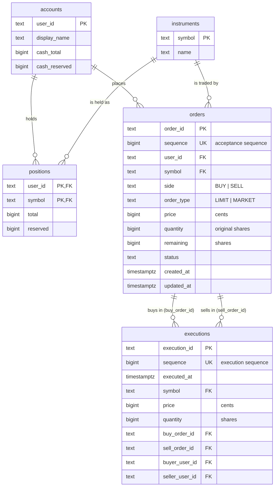

# PostgreSQL Schema Design

This document is the relational schema design for [issue #12](https://github.com/co-rtex/tradegrid/issues/12). It is the design that [#39](https://github.com/co-rtex/tradegrid/issues/39) turns into migrations and seeds, using the migration workflow from [#38](https://github.com/co-rtex/tradegrid/issues/38) ([`backend/db/README.md`](../backend/db/README.md)).

It is a design only. It adds no migrations, tables, driver, or runtime persistence. In Sprint 2 the exchange stays in memory and never writes to PostgreSQL ([api.md](api.md#database-mapping)).

The schema stores exactly the resources in the [Sprint 2 API contract](api.md): accounts with cash and positions, accepted orders, executions, and the tradable symbols. Where this document and `api.md`, [order-model.md](order-model.md), or [matching-engine.md](matching-engine.md) disagree, those documents win and this one is wrong.

## Summary

Five tables, all in the `public` schema next to the migration tool's `schema_migrations`:

| Table | One row per | Key |
| --- | --- | --- |
| `accounts` | Demo account, with its cash balance | `user_id` |
| `instruments` | Tradable symbol | `symbol` |
| `positions` | Account and symbol, with its share balance | `(user_id, symbol)` |
| `orders` | Accepted order, with its current remaining quantity and status | `order_id`; `sequence` is unique |
| `executions` | Trade between one buy order and one sell order | `execution_id`; `sequence` is unique |

The main decisions, each explained below:

1. **Keys are the API's own identifiers.** `user_id`, `symbol`, `order_id`, and `execution_id` store the exact strings the API returns, so foreign keys hold the same values as `buyOrderId` or `userId` and nothing needs translating.
2. **Sequences are stored, not generated.** Acceptance and execution sequences come from the exchange and are unique, positive, `NOT NULL` columns. Every ordered read sorts by them, never by a timestamp.
3. **Money and shares are `bigint` with explicit bounds.** Cents and shares never touch `numeric` or floating point, and every column has a `CHECK` that matches the contract's bounds.
4. **Balances store `total` and `reserved`; `available` is derived.** This mirrors `risk.Balance` exactly.
5. **Executions name both orders and both accounts, and composite foreign keys prove they agree.** An execution cannot claim a buyer that does not own its buy order.
6. **Enumerations are `text` with `CHECK`, not PostgreSQL `ENUM` types**, so the stored value is the wire value.
7. **`orders` holds accepted orders only.** `REJECTED` is not a storable status, because the contract stores no rejected orders and they have no acceptance sequence.

## Entity-Relationship Diagram



Executions reference accounts and instruments only through `orders`: the composite foreign key `(buy_order_id, buyer_user_id, symbol)` points at `orders (order_id, user_id, symbol)`, and `orders` in turn references `accounts` and `instruments`. A buyer, seller, or symbol on an execution therefore always exists.

## Conventions

These apply to every table.

| Topic | Rule | Why |
| --- | --- | --- |
| Names | `snake_case` tables (plural) and columns. API `camelCase` fields map one to one; see [Field Mapping](#field-mapping). | PostgreSQL folds unquoted names to lower case. |
| Money | `bigint` whole US cents. Never `numeric`, `real`, `double precision`, or `money`. | Exact integers, same range as Go `int64`. `money` depends on `lc_monetary`. |
| Quantities | `bigint` whole shares. | `price × quantity` up to `1e14` stays in `bigint`. With `integer` quantities, an `integer × integer` expression could overflow. |
| Upper bound | Every money, quantity, and sequence column is at most `9007199254740991` (`2^53 - 1`). | The contract's aggregate bound and JavaScript's largest safe integer. |
| Identifiers | `text COLLATE "C"`, non-empty, at most 64 characters. | `"C"` compares bytes, so `ORDER BY user_id` and `ORDER BY symbol` sort exactly like Go's `slices.Sort`, on any server locale. |
| Enumerations | `text COLLATE "C"` with a `CHECK (... IN (...))` of the exact uppercase wire values. | See [Text with CHECK instead of ENUM](#text-with-check-instead-of-enum). |
| Timestamps | `timestamptz`, stored and read in UTC. | See [Timestamps](#timestamps). |
| Nullability | Every column is `NOT NULL`. | No API field is optional, and every zero value has a meaning (`0` reserved, `0` remaining). |
| Defaults | No defaults on orders or executions. | IDs, sequences, statuses, and timestamps are generated by the exchange and must be stored exactly as it produced them. A default would hide a writer that forgot a value. |
| Deletes and updates | Foreign keys use the default `NO ACTION`. Nothing cascades. | Orders and executions are history. Deleting an account or instrument that history refers to must fail. |
| Constraint names | `<table>_<columns or purpose>_check`, `_fkey`, `_key`, `_pkey`, `_idx`, as in PostgreSQL's own generated names. The names below are the recommended ones. | Tests in #39 can assert which constraint rejected a row. |

`MAX` below means `9007199254740991`.

## Tables

### `accounts`

One row per demo account. `userId` is a demo selector, not authentication, so there is no separate `users` table yet; see [Accounts without users](#accounts-without-users). Cash lives here because every account has exactly one cash balance.

| Column | Type | Null | Default | Notes |
| --- | --- | --- | --- | --- |
| `user_id` | `text COLLATE "C"` | not null | — | Primary key. The API `userId`, for example `alice`. |
| `display_name` | `text` | not null | — | The API `displayName`, for example `Alice (demo)`. |
| `cash_total` | `bigint` | not null | — | Cash owned, in cents. |
| `cash_reserved` | `bigint` | not null | `0` | Cash held for open BUY orders, in cents. |

Constraints:

| Name | Definition |
| --- | --- |
| `accounts_pkey` | `PRIMARY KEY (user_id)` |
| `accounts_user_id_check` | `CHECK (char_length(user_id) BETWEEN 1 AND 64)` |
| `accounts_display_name_check` | `CHECK (char_length(display_name) BETWEEN 1 AND 100)` |
| `accounts_cash_total_check` | `CHECK (cash_total BETWEEN 0 AND 9007199254740991)` |
| `accounts_cash_reserved_check` | `CHECK (cash_reserved >= 0 AND cash_reserved <= cash_total)` |

The last two together are `risk.Balance.valid()`: `0 <= reserved <= total <= MAX`, which also keeps `available` in `[0, total]`. `cash_reserved` gets a `0` default only because a newly seeded account has nothing reserved.

Indexes: the primary key only. There are two rows.

### `instruments`

One row per tradable symbol. A separate table is justified even with two symbols:

- It is the foreign-key target that keeps `UNKNOWN_SYMBOL` values (including `aapl`) out of `orders`, `executions`, and `positions`.
- It stores the `name` that `GET /api/v1/symbols` returns, which belongs to no other table.
- It is the list every account's positions are built from: the API lists a position for every tradable symbol, including zero holdings.

| Column | Type | Null | Default | Notes |
| --- | --- | --- | --- | --- |
| `symbol` | `text COLLATE "C"` | not null | — | Primary key. The API `symbol`, for example `AAPL`. |
| `name` | `text` | not null | — | The API `name`, for example `Apple Inc.` |

Constraints:

| Name | Definition |
| --- | --- |
| `instruments_pkey` | `PRIMARY KEY (symbol)` |
| `instruments_symbol_check` | `CHECK (symbol ~ '^[A-Z]{1,16}$')` |
| `instruments_name_check` | `CHECK (char_length(name) BETWEEN 1 AND 200)` |

The symbol pattern encodes the contract's rule that symbols are exact uppercase strings; the server never normalizes case. Symbols with digits or dots (such as `BRK.B`) are an [open question](#open-questions).

There is deliberately no currency, tick size, lot size, or active flag. Every price is USD cents and every quantity is whole shares; the contract has no per-instrument trading rules yet ([order-model.md](order-model.md#out-of-scope)).

### `positions`

One row per account and symbol: how many shares the account owns and how many are reserved for its open SELL orders.

| Column | Type | Null | Default | Notes |
| --- | --- | --- | --- | --- |
| `user_id` | `text COLLATE "C"` | not null | — | References `accounts`. |
| `symbol` | `text COLLATE "C"` | not null | — | References `instruments`. |
| `total` | `bigint` | not null | `0` | Shares owned. |
| `reserved` | `bigint` | not null | `0` | Shares held for open SELL orders. |

Constraints:

| Name | Definition |
| --- | --- |
| `positions_pkey` | `PRIMARY KEY (user_id, symbol)` |
| `positions_user_id_fkey` | `FOREIGN KEY (user_id) REFERENCES accounts (user_id)` |
| `positions_symbol_fkey` | `FOREIGN KEY (symbol) REFERENCES instruments (symbol)` |
| `positions_total_check` | `CHECK (total BETWEEN 0 AND 9007199254740991)` |
| `positions_reserved_check` | `CHECK (reserved >= 0 AND reserved <= total)` |

`total >= 0` is the no-short-selling rule: no account can owe shares.

**Missing row means zero.** The seed creates a row for every account and instrument, so in practice all rows exist. Readers still treat a missing row as `total = 0, reserved = 0` (see [the accounts query](#get-apiv1accounts)), and a writer that settles a first purchase of a new instrument inserts the row. That keeps adding an instrument from requiring a backfill before it can be read.

Indexes: the primary key serves "positions of one account" and the account snapshot. `positions_symbol_fkey` needs no index of its own: instruments are never deleted while positions refer to them, and the table has one row per account and symbol.

### `orders`

One row per **accepted** order. The row is created when the exchange accepts the order and is updated as it fills (and, later, when it is canceled). `quantity` never changes; `remaining`, `status`, and `updated_at` do. A rejected submission never reaches this table.

| Column | Type | Null | Default | Notes |
| --- | --- | --- | --- | --- |
| `order_id` | `text COLLATE "C"` | not null | — | Primary key. The server-generated API `id`, for example `ord-2`. Opaque. |
| `sequence` | `bigint` | not null | — | The acceptance sequence. Unique; defines time priority. |
| `user_id` | `text COLLATE "C"` | not null | — | References `accounts`. |
| `symbol` | `text COLLATE "C"` | not null | — | References `instruments`. |
| `side` | `text COLLATE "C"` | not null | — | `BUY` or `SELL`. |
| `order_type` | `text COLLATE "C"` | not null | — | `LIMIT` or `MARKET`. Named `order_type` because `type` is an SQL keyword; the API field stays `type`. |
| `price` | `bigint` | not null | — | Limit price in cents; `0` for a market order. |
| `quantity` | `bigint` | not null | — | Original quantity in shares. Never changes. |
| `remaining` | `bigint` | not null | — | Quantity not yet traded. |
| `status` | `text COLLATE "C"` | not null | — | `NEW`, `PARTIALLY_FILLED`, `FILLED`, or `CANCELED`. |
| `created_at` | `timestamptz` | not null | — | When the order was accepted. |
| `updated_at` | `timestamptz` | not null | — | When the order last changed. |

Constraints:

| Name | Definition |
| --- | --- |
| `orders_pkey` | `PRIMARY KEY (order_id)` |
| `orders_sequence_key` | `UNIQUE (sequence)` |
| `orders_order_id_user_id_symbol_key` | `UNIQUE (order_id, user_id, symbol)`. Trivially true because `order_id` is the key; PostgreSQL needs it as the target of the executions' composite foreign keys. |
| `orders_user_id_fkey` | `FOREIGN KEY (user_id) REFERENCES accounts (user_id)` |
| `orders_symbol_fkey` | `FOREIGN KEY (symbol) REFERENCES instruments (symbol)` |
| `orders_order_id_check` | `CHECK (char_length(order_id) BETWEEN 1 AND 64)` |
| `orders_sequence_check` | `CHECK (sequence BETWEEN 1 AND 9007199254740991)` |
| `orders_side_check` | `CHECK (side IN ('BUY', 'SELL'))` |
| `orders_order_type_check` | `CHECK (order_type IN ('LIMIT', 'MARKET'))` |
| `orders_price_check` | `CHECK ((order_type = 'LIMIT' AND price BETWEEN 1 AND 100000000) OR (order_type = 'MARKET' AND price = 0))` |
| `orders_quantity_check` | `CHECK (quantity BETWEEN 1 AND 1000000)` |
| `orders_remaining_check` | `CHECK (remaining >= 0 AND remaining <= quantity)` |
| `orders_status_check` | `CHECK (status IN ('NEW', 'PARTIALLY_FILLED', 'FILLED', 'CANCELED'))` |
| `orders_status_remaining_check` | see below |
| `orders_updated_at_check` | `CHECK (updated_at >= created_at AND (status <> 'NEW' OR updated_at = created_at))` |

`orders_status_remaining_check` is order-model invariants 7 to 10, the combinations that make a status meaningful:

```sql
CHECK (
       (status = 'NEW'              AND remaining = quantity)
    OR (status = 'PARTIALLY_FILLED' AND remaining > 0 AND remaining < quantity)
    OR (status = 'FILLED'           AND remaining = 0)
    OR (status = 'CANCELED'         AND remaining > 0)
)
```

`orders_updated_at_check` stores invariant 11: `UpdatedAt` equals `CreatedAt` until the first fill or cancellation, and a `NEW` order has had neither. A `PARTIALLY_FILLED` or `FILLED` order may still have `updated_at = created_at` when it filled during its own submission, as `ord-2` does in [fixture 03](fixtures/03-partial-fill.json).

`MARKET` and `CANCELED` are allowed although Sprint 2 never produces them. Both are members of the order model, and the model keeps `MARKET` "so that adding the behavior later does not require changing the shape of every order that has already been stored". `REJECTED` is excluded on purpose; see [Rejected orders are not stored](#rejected-orders-are-not-stored).

Indexes:

| Name | Definition | Serves |
| --- | --- | --- |
| `orders_pkey` | `(order_id)` | Lookups by ID; foreign keys from executions. |
| `orders_sequence_key` | `(sequence)` | Uniqueness; `asOfSequence` (`max(sequence)`); replaying open orders in acceptance order. |
| `orders_order_id_user_id_symbol_key` | `(order_id, user_id, symbol)` | Required target of the executions' composite foreign keys. |
| `orders_user_id_sequence_idx` | `(user_id, sequence DESC)` | `GET /orders?userId=…`, newest first. Also covers `orders_user_id_fkey`. |
| `orders_open_book_idx` | `(symbol, side, price) INCLUDE (remaining) WHERE status IN ('NEW', 'PARTIALLY_FILLED')` | `GET /orderbook`, reservation reconciliation, and rebuilding the book. Partial, so it holds only resting orders. |

### `executions`

One row per trade: one incoming order matched against one resting order, at the resting order's price. An order has zero or more executions; every execution has exactly one buy order and one sell order. Rows are never updated or deleted.

| Column | Type | Null | Default | Notes |
| --- | --- | --- | --- | --- |
| `execution_id` | `text COLLATE "C"` | not null | — | Primary key. The server-generated API `id`, for example `exe-1`. Opaque. |
| `sequence` | `bigint` | not null | — | The execution sequence. Unique; defines execution order. |
| `executed_at` | `timestamptz` | not null | — | When the trade happened. |
| `symbol` | `text COLLATE "C"` | not null | — | Must equal both orders' symbol. |
| `price` | `bigint` | not null | — | Execution price in cents: the resting order's limit. |
| `quantity` | `bigint` | not null | — | Shares traded. |
| `buy_order_id` | `text COLLATE "C"` | not null | — | The BUY order. |
| `sell_order_id` | `text COLLATE "C"` | not null | — | The SELL order. |
| `buyer_user_id` | `text COLLATE "C"` | not null | — | Owner of `buy_order_id`. |
| `seller_user_id` | `text COLLATE "C"` | not null | — | Owner of `sell_order_id`. May equal `buyer_user_id`. |

Constraints:

| Name | Definition |
| --- | --- |
| `executions_pkey` | `PRIMARY KEY (execution_id)` |
| `executions_sequence_key` | `UNIQUE (sequence)` |
| `executions_buy_order_fkey` | `FOREIGN KEY (buy_order_id, buyer_user_id, symbol) REFERENCES orders (order_id, user_id, symbol)` |
| `executions_sell_order_fkey` | `FOREIGN KEY (sell_order_id, seller_user_id, symbol) REFERENCES orders (order_id, user_id, symbol)` |
| `executions_execution_id_check` | `CHECK (char_length(execution_id) BETWEEN 1 AND 64)` |
| `executions_sequence_check` | `CHECK (sequence BETWEEN 1 AND 9007199254740991)` |
| `executions_price_check` | `CHECK (price BETWEEN 1 AND 100000000)` |
| `executions_quantity_check` | `CHECK (quantity BETWEEN 1 AND 1000000)` |
| `executions_distinct_orders_check` | `CHECK (buy_order_id <> sell_order_id)` |

There is intentionally **no** `CHECK (buyer_user_id <> seller_user_id)`: same-account trades are allowed and recorded as normal executions ([api.md](api.md#reservations-and-settlement)).

Indexes:

| Name | Definition | Serves |
| --- | --- | --- |
| `executions_pkey` | `(execution_id)` | Lookups by ID. |
| `executions_sequence_key` | `(sequence)` | Uniqueness; global execution history in order. |
| `executions_symbol_sequence_idx` | `(symbol, sequence DESC)` | `GET /executions?symbol=…`, newest first. |
| `executions_buyer_symbol_sequence_idx` | `(buyer_user_id, symbol, sequence DESC)` | `GET /executions?symbol=…&userId=…` (buyer half). |
| `executions_seller_symbol_sequence_idx` | `(seller_user_id, symbol, sequence DESC)` | `GET /executions?symbol=…&userId=…` (seller half). |
| `executions_buy_order_id_idx` | `(buy_order_id)` | Fills of one order; covers `executions_buy_order_fkey`. |
| `executions_sell_order_id_idx` | `(sell_order_id)` | Fills of one order; covers `executions_sell_order_fkey`. |

## Keys and Relationships

### Primary keys

| Table | Primary key | Kind |
| --- | --- | --- |
| `accounts` | `user_id` | Natural: the API's `userId`. |
| `instruments` | `symbol` | Natural: the ticker. |
| `positions` | `(user_id, symbol)` | Composite of two foreign keys: at most one balance per account and symbol. |
| `orders` | `order_id` | The exchange-generated opaque ID. |
| `executions` | `execution_id` | The exchange-generated opaque ID. |

There are no surrogate `bigserial` keys. The API's identifiers are already unique, stable strings, and storing them directly means a row and its JSON form share every key. A surrogate key would add a second identity for each order that the API never exposes, and every execution read would need a join to translate it back. At TradeGrid's size the cost of `text` keys is negligible.

`order_id` and `sequence` are stored separately even though the default ID generator derives `ord-N` from sequence `N`. The contract makes IDs opaque, `exchange.Config` lets tests replace the generator, and nothing may parse an ID to recover its sequence.

### Foreign keys

| Foreign key | From | To | Guarantees |
| --- | --- | --- | --- |
| `positions_user_id_fkey` | `positions (user_id)` | `accounts (user_id)` | A balance belongs to a real account. |
| `positions_symbol_fkey` | `positions (symbol)` | `instruments (symbol)` | A balance is in a tradable symbol. |
| `orders_user_id_fkey` | `orders (user_id)` | `accounts (user_id)` | An order belongs to a real account. |
| `orders_symbol_fkey` | `orders (symbol)` | `instruments (symbol)` | An order is in a tradable symbol. |
| `executions_buy_order_fkey` | `executions (buy_order_id, buyer_user_id, symbol)` | `orders (order_id, user_id, symbol)` | The buy order exists, belongs to the named buyer, and is in the execution's symbol. |
| `executions_sell_order_fkey` | `executions (sell_order_id, seller_user_id, symbol)` | `orders (order_id, user_id, symbol)` | Same for the sell order and seller. |

The composite keys are why `buyer_user_id` and `seller_user_id` can be stored safely. They duplicate `orders.user_id`, which the API needs on every execution (`buyerUserId`, `sellerUserId`), and the database rejects any row where the copy disagrees with the order. The same holds for `symbol`. This is the same consistency check that `counterparty` in `backend/internal/accounts/ledger.go` performs before settlement.

The composite keys cannot check side: nothing in a foreign key stops `buy_order_id` from naming a SELL order. Side, price limits, and fill totals are cross-row rules, listed under [Invariants enforced outside constraints](#invariants-enforced-outside-constraints).

## Orders and Executions

The relationship is many-to-many through `executions`, with each execution having exactly two order references:

- Every execution names one BUY order (`buy_order_id`) and one SELL order (`sell_order_id`), and the two are different orders.
- An order can appear in any number of executions, always on its own side. A BUY order only ever appears as `buy_order_id`.
- **Partial fills and multiple fills.** An order's filled quantity is the sum of its executions' quantities:

  ```text
  quantity - remaining = sum(executions.quantity) over the order's executions
  ```

  `orders.remaining` is stored, not computed from this sum, for the reasons under [Authoritative and derived state](#authoritative-and-derived-state). The equality is a reconciliation check.
- **One execution per resting order.** When an incoming order walks several resting orders, each pair produces its own row, even at the same price (matching invariant 13). See [Example 4](#example-4-one-order-several-executions).
- **Which order was resting.** It is the one with the smaller acceptance `sequence`: an incoming order is always the newest accepted order, so every order it trades with was accepted before it. The execution price equals that order's `price`. Neither "resting" nor "aggressor" needs a column.
- **Same-account trades.** `buyer_user_id = seller_user_id` is a normal row. See [Example 5](#example-5-same-account-trade).

### Ordering without timestamps

Equal timestamps are expected: every execution from one submission shares that submission's time, and fixtures put several events in the same second. The schema therefore never orders by time.

| Order needed | Column | Unique? |
| --- | --- | --- |
| Time priority between orders; "newest first" order lists; `asOfSequence` | `orders.sequence` | Yes (`orders_sequence_key`) |
| Execution history, newest first or oldest first | `executions.sequence` | Yes (`executions_sequence_key`) |
| FIFO inside a price level when rebuilding the book | `orders.sequence` | Yes |

The two counters are independent, as in the contract: each starts at 1 and strictly increases. Because the exchange records one submission's executions before the next submission's, `executions.sequence` order also agrees with the acceptance order of the incoming orders.

A partially filled resting order keeps its priority because its `sequence` never changes; only `remaining` does.

## Authoritative and Derived State

**Authoritative** values are stored and cannot be recomputed from other rows. **Derived** values are computed when read and are never stored. **Stored with a reconciliation check** means the value could in principle be recomputed, but it is stored because the runtime treats it as state, and a validation query proves the stored value and the recomputed value agree.

| Value | Where | Kind | Notes |
| --- | --- | --- | --- |
| Account identity, display name | `accounts` | Authoritative | Seeded. |
| Symbol, name | `instruments` | Authoritative | Seeded. |
| Order fields given at acceptance (`user_id`, `symbol`, `side`, `order_type`, `price`, `quantity`, `created_at`) | `orders` | Authoritative | Immutable after insert. |
| `order_id`, `sequence` | `orders` | Authoritative | Generated by the exchange. |
| `remaining`, `status`, `updated_at` | `orders` | Stored with a reconciliation check | `remaining = quantity - Σ fills`. `status` follows from `remaining` and `quantity` except that `CANCELED` cannot be told apart from an open order by quantities alone, so `status` must be stored. |
| Every execution column | `executions` | Authoritative | Append-only history. |
| `cash_total`, positions `total` | `accounts`, `positions` | Stored with a reconciliation check | Equal to the seeded balance plus the net of the account's executions. Stored because deposits, resets, and fees would break the recomputation, and `GET /accounts` should not replay history. |
| `cash_reserved`, positions `reserved` | `accounts`, `positions` | Stored with a reconciliation check | Equal to what open orders still need, exactly as `Ledger.Reconcile` checks. |
| `available` (cash and positions) | — | Derived | `total - reserved`. |
| Filled quantity of an order | — | Derived | `quantity - remaining`. |
| Order book levels: `price`, `quantity`, `orderCount` | — | Derived | Aggregate of open orders. |
| `asOfSequence` | — | Derived | `max(orders.sequence)`, or `0` with no orders. |
| Which order was resting in an execution | — | Derived | The one with the smaller acceptance sequence. |
| Average fill price, cost basis, P&L | — | Not modeled | Portfolio work in a later milestone. The order model deliberately keeps average price off the order. |

### Why reservations are stored as totals, not per order

The ledger (`risk.Balance{Total, Reserved}`) holds one reserved amount per asset, and the schema mirrors it. A per-order `reservations` table would add nothing: an open order's reservation is fully determined by its own row, `price × remaining` cash for a BUY and `remaining` shares for a SELL. So the rule for each account is:

```text
cash_reserved           = Σ price × remaining   over its open BUY orders
positions.reserved[sym] = Σ remaining           over its open SELL orders in sym
```

Price improvement does not break this. A BUY reserves at its limit `L`; a fill at `p < L` releases `L × q` from `cash_reserved` while charging only `p × q` to `cash_total`, and the remaining reservation is still `L × remaining`.

## Recommended Queries

These sketches show how each planned read uses the indexes. They are illustrative, not part of the schema. Placeholders such as `$1` are bind parameters.

`sum(bigint)` returns `numeric` in PostgreSQL. Cast sums back to `bigint`; the contract's bounds (enforced by the exchange as `LIMIT_EXCEEDED`) keep them at most `MAX`, so the cast cannot fail.

### `GET /api/v1/accounts`

```sql
SELECT user_id, display_name,
       cash_total, cash_reserved, cash_total - cash_reserved AS cash_available
  FROM accounts
 ORDER BY user_id;

SELECT a.user_id, i.symbol,
       COALESCE(p.total, 0)                    AS total,
       COALESCE(p.reserved, 0)                 AS reserved,
       COALESCE(p.total - p.reserved, 0)       AS available
  FROM accounts a
 CROSS JOIN instruments i
  LEFT JOIN positions p ON p.user_id = a.user_id AND p.symbol = i.symbol
 ORDER BY a.user_id, i.symbol;
```

Both queries run in one `REPEATABLE READ` transaction so they describe the same moment, matching "every endpoint returns a coherent snapshot".

### `GET /api/v1/orders?userId=…&limit=…`

```sql
SELECT order_id, user_id, symbol, side, order_type, price, quantity, remaining,
       status, sequence, created_at, updated_at
  FROM orders
 WHERE user_id = $1
 ORDER BY sequence DESC
 LIMIT $2;
```

Uses `orders_user_id_sequence_idx`.

### `GET /api/v1/orderbook?symbol=…&depth=…`

```sql
SELECT price, sum(remaining)::bigint AS quantity, count(*) AS order_count
  FROM orders
 WHERE symbol = $1 AND side = 'BUY' AND status IN ('NEW', 'PARTIALLY_FILLED')
 GROUP BY price
 ORDER BY price DESC
 LIMIT $2;
-- Asks: side = 'SELL' and ORDER BY price ASC.

SELECT COALESCE(max(sequence), 0) AS as_of_sequence FROM orders;
```

The level queries use `orders_open_book_idx`; `asOfSequence` uses `orders_sequence_key`. `asOfSequence` is global across symbols, like `exchange.BookSnapshot.AsOfSequence`.

### `GET /api/v1/executions?symbol=…&userId=…&limit=…`

```sql
SELECT execution_id, sequence, executed_at, symbol, price, quantity,
       buy_order_id, sell_order_id, buyer_user_id, seller_user_id
  FROM executions
 WHERE symbol = $1
   AND ($2::text IS NULL OR buyer_user_id = $2 OR seller_user_id = $2)
 ORDER BY sequence DESC
 LIMIT $3;
```

Without `userId`, this uses `executions_symbol_sequence_idx`. With it, PostgreSQL can combine the buyer and seller indexes. Use `OR`, not `UNION ALL`: a same-account execution matches both halves and must appear once.

### `GET /api/v1/symbols`

```sql
SELECT symbol, name FROM instruments ORDER BY symbol;
```

### Rebuilding the book (future recovery)

```sql
SELECT order_id, user_id, symbol, side, price, remaining, sequence
  FROM orders
 WHERE status IN ('NEW', 'PARTIALLY_FILLED')
 ORDER BY sequence;
```

Inserting these orders into an empty book in acceptance order reproduces both price priority and FIFO at every level. Recovery is a later milestone; the query shows the schema already holds what it needs.

## Examples

All examples start from the seed and follow the fixtures' conventions: IDs `ord-N` and `exe-N`, and submission `N` at `2026-10-20T15:00:0NZ`. Unchanged rows are not repeated.

### Seed state

`instruments`:

| symbol | name |
| --- | --- |
| `AAPL` | `Apple Inc.` |
| `MSFT` | `Microsoft Corporation` |

`accounts`:

| user_id | display_name | cash_total | cash_reserved |
| --- | --- | --- | --- |
| `alice` | `Alice (demo)` | 10000000 | 0 |
| `bob` | `Bob (demo)` | 10000000 | 0 |

`positions`:

| user_id | symbol | total | reserved |
| --- | --- | --- | --- |
| `alice` | `AAPL` | 100 | 0 |
| `alice` | `MSFT` | 100 | 0 |
| `bob` | `AAPL` | 100 | 0 |
| `bob` | `MSFT` | 100 | 0 |

`orders` and `executions` are empty. This is [fixture 00](fixtures/00-seed.json).

### Example 1: resting order

[Fixture 01](fixtures/01-no-fill.json): Alice sells 10 AAPL at $190.00 into an empty book.

`orders`:

| order_id | sequence | user_id | symbol | side | order_type | price | quantity | remaining | status | created_at | updated_at |
| --- | --- | --- | --- | --- | --- | --- | --- | --- | --- | --- | --- |
| `ord-1` | 1 | `alice` | `AAPL` | `SELL` | `LIMIT` | 19000 | 10 | 10 | `NEW` | `15:00:01Z` | `15:00:01Z` |

`positions` (`alice`, `AAPL`): `total = 100`, `reserved = 10`. No executions. The book query returns one ask level: `19000 × 10`, `orderCount = 1`.

### Example 2: completed execution with price improvement

[Fixture 02](fixtures/02-full-fill.json): after Example 1, Bob buys 10 AAPL with a $191.00 limit. Bob reserves `19100 × 10 = 191000`, then fills at Alice's $190.00.

`orders`:

| order_id | sequence | side | price | quantity | remaining | status | created_at | updated_at |
| --- | --- | --- | --- | --- | --- | --- | --- | --- |
| `ord-1` | 1 | `SELL` | 19000 | 10 | 0 | `FILLED` | `15:00:01Z` | `15:00:02Z` |
| `ord-2` | 2 | `BUY` | 19100 | 10 | 0 | `FILLED` | `15:00:02Z` | `15:00:02Z` |

`executions`:

| execution_id | sequence | executed_at | symbol | price | quantity | buy_order_id | sell_order_id | buyer_user_id | seller_user_id |
| --- | --- | --- | --- | --- | --- | --- | --- | --- | --- |
| `exe-1` | 1 | `15:00:02Z` | `AAPL` | 19000 | 10 | `ord-2` | `ord-1` | `bob` | `alice` |

Balances:

| Row | total | reserved | How |
| --- | --- | --- | --- |
| `accounts` `alice` cash | 10190000 | 0 | `+ 19000 × 10` |
| `accounts` `bob` cash | 9810000 | 0 | `- 19000 × 10`; reservation `191000` released in full, so `(19100 - 19000) × 10 = 1000` of price improvement returns to available cash |
| `positions` `alice` `AAPL` | 90 | 0 | `- 10` total, `- 10` reserved |
| `positions` `bob` `AAPL` | 110 | 0 | `+ 10` |

### Example 3: partial fill

[Fixture 03](fixtures/03-partial-fill.json): after Example 1, Bob instead buys 25 AAPL at $190.50. 10 fill at $190.00 and 15 rest.

`orders`:

| order_id | sequence | side | price | quantity | remaining | status | created_at | updated_at |
| --- | --- | --- | --- | --- | --- | --- | --- | --- |
| `ord-1` | 1 | `SELL` | 19000 | 10 | 0 | `FILLED` | `15:00:01Z` | `15:00:02Z` |
| `ord-2` | 2 | `BUY` | 19050 | 25 | 15 | `PARTIALLY_FILLED` | `15:00:02Z` | `15:00:02Z` |

`executions`: one row, `exe-1`, with the same values as in Example 2. Its `buy_order_id = 'ord-2'` is now the 25-share order.

Balances: Alice is as in Example 2. Bob's cash is `total = 9810000`, `reserved = 285750`: he reserved `19050 × 25 = 476250`, the fill released `19050 × 10 = 190500`, and `19050 × 15 = 285750` remains for the resting 15 shares. `positions` (`bob`, `AAPL`): `total = 110`.

Checks: `ord-2` has `25 - 15 = 10` filled, which equals its one execution's quantity. `cash_reserved` equals `price × remaining` of Bob's one open BUY.

### Example 4: one order, several executions

Not a fixture; it shows an incoming order walking two resting orders, and a resting order that stays partly filled.

1. `ord-1`: Alice sells 5 AAPL at $190.00.
2. `ord-2`: Alice sells 8 AAPL at $191.00. Alice's AAPL `reserved` is now 13.
3. `ord-3`: Bob buys 10 AAPL at $192.00, reserving `19200 × 10 = 192000`. It takes all of `ord-1` at $190.00, then 5 of `ord-2` at $191.00.

`orders` afterwards:

| order_id | sequence | side | price | quantity | remaining | status | updated_at |
| --- | --- | --- | --- | --- | --- | --- | --- |
| `ord-1` | 1 | `SELL` | 19000 | 5 | 0 | `FILLED` | `15:00:03Z` |
| `ord-2` | 2 | `SELL` | 19100 | 8 | 3 | `PARTIALLY_FILLED` | `15:00:03Z` |
| `ord-3` | 3 | `BUY` | 19200 | 10 | 0 | `FILLED` | `15:00:03Z` |

`executions`:

| execution_id | sequence | executed_at | price | quantity | buy_order_id | sell_order_id | buyer_user_id | seller_user_id |
| --- | --- | --- | --- | --- | --- | --- | --- | --- |
| `exe-1` | 1 | `15:00:03Z` | 19000 | 5 | `ord-3` | `ord-1` | `bob` | `alice` |
| `exe-2` | 2 | `15:00:03Z` | 19100 | 5 | `ord-3` | `ord-2` | `bob` | `alice` |

Both executions share a timestamp; `sequence` alone records that `exe-1` came first. `ord-3`'s fills sum to `5 + 5 = 10 = 10 - 0`, and `ord-2`'s to `5 = 8 - 3`.

Balances:

| Row | total | reserved | How |
| --- | --- | --- | --- |
| `alice` cash | 10190500 | 0 | `+ 95000 + 95500` |
| `bob` cash | 9809500 | 0 | `- 95000 - 95500`; `192000` reserved, `96000 + 96000` released |
| `alice` `AAPL` | 90 | 3 | `- 5 - 5`; reserved `13 - 5 - 5 = 3`, which is `ord-2`'s remaining |
| `bob` `AAPL` | 110 | 0 | `+ 5 + 5` |

### Example 5: same-account trade

Not a fixture; it shows the contract's same-account settlement.

1. `ord-1`: Alice sells 4 MSFT at $400.00. Alice's MSFT `reserved = 4`.
2. `ord-2`: Alice buys 4 MSFT at $401.00, reserving `40100 × 4 = 160400`. It matches `ord-1` at $400.00.

`executions`:

| execution_id | sequence | price | quantity | buy_order_id | sell_order_id | buyer_user_id | seller_user_id |
| --- | --- | --- | --- | --- | --- | --- | --- |
| `exe-1` | 1 | 40000 | 4 | `ord-2` | `ord-1` | `alice` | `alice` |

Both orders are `FILLED` with `remaining = 0`. Both composite foreign keys point at Alice's own orders, and no constraint objects to `buyer_user_id = seller_user_id`. The netted deltas leave Alice exactly at her seed balances: cash `total` changes by `-160000 + 160000 = 0`, cash `reserved` falls by `160400` to 0, MSFT `total` by `-4 + 4 = 0`, and MSFT `reserved` by 4 to 0.

## Field Mapping

### Order (`exchange.Order`, embedding `orders.Order`) → `orders`

| Go field | JSON | Column | Conversion |
| --- | --- | --- | --- |
| `ID` | `id` | `order_id` | Same string. |
| `Sequence` (`exchange.Order`) | `sequence` | `sequence` | Same integer. |
| `UserID` | `userId` | `user_id` | Same string. |
| `Symbol` | `symbol` | `symbol` | Same string. |
| `Side` | `side` | `side` | `Side.String()` / `ParseSide`. The zero value `UNSPECIFIED` is never stored. |
| `Type` | `type` | `order_type` | `Type.String()` / `ParseType`. |
| `Price` | `price` | `price` | `int64` cents ↔ `bigint`. |
| `Quantity` | `quantity` | `quantity` | `int64` ↔ `bigint`. |
| `Remaining` | `remaining` | `remaining` | `int64` ↔ `bigint`. |
| `Status` | `status` | `status` | `Status.String()` / `ParseStatus`. |
| `CreatedAt` | `createdAt` | `created_at` | `time.Time` (UTC) ↔ `timestamptz`. |
| `UpdatedAt` | `updatedAt` | `updated_at` | `time.Time` (UTC) ↔ `timestamptz`. |
| `Filled()` | — | — | Derived: `quantity - remaining`. |

### Execution (`executions.Record`) → `executions`

| Go field | JSON | Column |
| --- | --- | --- |
| `ID` | `id` | `execution_id` |
| `Sequence` | `sequence` | `sequence` |
| `ExecutedAt` | `executedAt` | `executed_at` |
| `Symbol` | `symbol` | `symbol` |
| `Price` | `price` | `price` |
| `Quantity` | `quantity` | `quantity` |
| `BuyOrderID` | `buyOrderId` | `buy_order_id` |
| `SellOrderID` | `sellOrderId` | `sell_order_id` |
| `BuyerUserID` | `buyerUserId` | `buyer_user_id` |
| `SellerUserID` | `sellerUserId` | `seller_user_id` |

### Account (`accounts.Snapshot`, `risk.Account`) → `accounts`, `positions`

| Go field | JSON | Column |
| --- | --- | --- |
| `Snapshot.UserID` | `userId` | `accounts.user_id` |
| `Snapshot.DisplayName` | `displayName` | `accounts.display_name` |
| `Snapshot.Cash.Total` (`risk.Account.Cash.Total`) | `cash.total` | `accounts.cash_total` |
| `Snapshot.Cash.Reserved` | `cash.reserved` | `accounts.cash_reserved` |
| `Snapshot.Cash.Available` | `cash.available` | Derived: `cash_total - cash_reserved` |
| `Position.Symbol` (key of `risk.Account.Positions`) | `positions[].symbol` | `positions.symbol` |
| `Position.Total` | `positions[].total` | `positions.total` |
| `Position.Reserved` | `positions[].reserved` | `positions.reserved` |
| `Position.Available` | `positions[].available` | Derived: `total - reserved` |
| `DemoCash`, `DemoShares` (`accounts/seed.go`) | — | Seed values for `cash_total` and `total` |

### Symbols and the book

| Go / API | Column or query |
| --- | --- |
| `GET /symbols` `symbol`, `name` | `instruments.symbol`, `instruments.name` |
| `exchange.BookSnapshot.Symbol` | Query parameter. |
| `exchange.BookSnapshot.AsOfSequence` | Derived: `COALESCE(max(orders.sequence), 0)`. |
| `exchange.Level{Price, Quantity, OrderCount}` | Derived: open orders grouped by `price`. |
| `exchange.SubmitRequest` | Not stored; it becomes an `orders` row only once accepted. |
| `exchange.Error` codes | Not stored; rejected submissions leave no row. |

## Invariants

### Order model invariants

Each invariant from [order-model.md](order-model.md#invariants), and what enforces it in the database:

| # | Invariant | Enforcement |
| --- | --- | --- |
| 1 | `Quantity > 0` | `orders_quantity_check` (with the contract's upper bound). |
| 2 | `0 <= Remaining <= Quantity` | `orders_remaining_check`. |
| 3 | `Quantity = filled + Remaining`; `Quantity` never changes | `quantity` is never updated (writer rule). The fill equality is [validation query V1](#invariants-enforced-outside-constraints). |
| 4 | Enumerations are members; zero value never is | `orders_side_check`, `orders_order_type_check`, `orders_status_check`. |
| 5 | `ID`, `UserID`, `Symbol` non-empty | `orders_order_id_check`; the two foreign keys (referenced keys are non-empty). |
| 6 | LIMIT `Price > 0`; MARKET `Price = 0` | `orders_price_check` (with the contract's price bounds). |
| 7 | `NEW` (and `REJECTED`) imply `Remaining = Quantity` | `orders_status_remaining_check`. `REJECTED` cannot be stored. |
| 8 | `PARTIALLY_FILLED` implies `0 < Remaining < Quantity` | `orders_status_remaining_check`. |
| 9 | `FILLED` implies `Remaining = 0` | `orders_status_remaining_check`. |
| 10 | `CANCELED` implies `Remaining > 0` | `orders_status_remaining_check`. |
| 11 | Timestamps set; `UpdatedAt` moves only on change | `NOT NULL`; `orders_updated_at_check`. |

### Account invariants

| Invariant | Enforcement |
| --- | --- |
| `0 <= reserved <= total <= MAX` for cash and every position | `accounts_cash_*_check`, `positions_*_check`. |
| No short selling | `positions_total_check` (`total >= 0`). |
| Every balance belongs to a real account and symbol | `positions_*_fkey`. |

### Invariants enforced outside constraints

These rules span rows, so a `CHECK` cannot express them. The exchange enforces them when it writes, and #39 should run each query below in its validation tests; each must return no rows.

| ID | Rule | Query sketch |
| --- | --- | --- |
| V1 | Every order's filled quantity equals the sum of its executions. | `SELECT o.order_id FROM orders o LEFT JOIN executions e ON o.order_id IN (e.buy_order_id, e.sell_order_id) GROUP BY o.order_id, o.quantity, o.remaining HAVING o.quantity - o.remaining <> COALESCE(sum(e.quantity), 0);` |
| V2 | `buy_order_id` names a BUY order and `sell_order_id` a SELL order. | `SELECT e.execution_id FROM executions e JOIN orders b ON b.order_id = e.buy_order_id JOIN orders s ON s.order_id = e.sell_order_id WHERE b.side <> 'BUY' OR s.side <> 'SELL';` |
| V3 | Execution price equals the resting (earlier-accepted) order's price and lies within both limits. | `... WHERE NOT (s.price <= e.price AND e.price <= b.price AND e.price = CASE WHEN b.sequence < s.sequence THEN b.price ELSE s.price END);` (same joins as V2) |
| V4 | Both orders are LIMIT orders, and the execution is no earlier than either order's acceptance. | `... WHERE b.order_type <> 'LIMIT' OR s.order_type <> 'LIMIT' OR e.executed_at < greatest(b.created_at, s.created_at);` |
| V5 | Execution order agrees with acceptance order: as `executions.sequence` increases, the incoming order's acceptance sequence never decreases. | Compute `greatest(b.sequence, s.sequence)` per execution, then compare with `lag(...) OVER (ORDER BY e.sequence)`. |
| V6 | Reservations equal what open orders need. | Per account, compare `cash_reserved` with `Σ price × remaining` over open BUY orders, and each `positions.reserved` with `Σ remaining` over open SELL orders in that symbol. |
| V7 | Totals equal seed plus executions. | Per account, compare `cash_total` with `10000000 + Σ (price × quantity as seller) - Σ (price × quantity as buyer)`, and each position `total` with `100 + Σ bought - Σ sold`. Valid while the only cash and share movements are seeds and executions. |
| V8 | Order-book level quantities stay within `MAX`. | `SELECT symbol, side, price FROM orders WHERE status IN ('NEW','PARTIALLY_FILLED') GROUP BY 1, 2, 3 HAVING sum(remaining) > 9007199254740991;` |

V6 and V7 are also what `Ledger.Reconcile` and the settlement tests check in memory.

Triggers that enforce V1 to V5 on every write are possible but deferred: no writer exists in Sprint 2, and the exchange is designed to be the single serialized writer. See [open questions](#open-questions).

## Design Decisions

### Accounts without users

The issue lists "users / accounts". The contract has exactly one account per `userId` and no authentication, so one `accounts` table keyed by `user_id` covers both. When authentication arrives, a `users` table (credentials, email) can be added and referenced from `accounts`, or `accounts` can gain a separate `account_id`. That is a later decision with real requirements behind it; inventing a `users` table now would create a shape no contract describes.

### Rejected orders are not stored

The contract says a rejected submission creates no order, no reservation, and no execution, and is not stored; rejected-order persistence is deferred. A rejected submission also never receives an acceptance sequence, so it could not satisfy `orders.sequence NOT NULL UNIQUE` without inventing a second numbering. `orders_status_check` therefore excludes `REJECTED`, which makes "rejected orders are not stored" a database rule rather than a convention.

If rejected submissions are persisted later (for audit), they belong in their own table, for example `order_rejections` with the submitted fields, the error `code`, and a timestamp. That keeps `orders` meaning "accepted orders" and keeps every reservation and reconciliation query free of a `status <> 'REJECTED'` filter.

### Text with CHECK instead of ENUM

PostgreSQL `ENUM` types would also work, but `text` with `CHECK`:

- stores and returns the exact wire value (`'PARTIALLY_FILLED'`), with no cast at the boundary;
- can be changed with an ordinary `DROP CONSTRAINT` / `ADD CONSTRAINT` in a new migration. A new `ENUM` value cannot be used in the same transaction that adds it, and the migration tool runs every file in one transaction; a value can never be removed from an `ENUM`;
- sorts by the stored text, not by declaration order, so there is no hidden ordering to rely on.

### Integer types and bounds

`bigint` everywhere rather than `integer` for quantities: `quantity` alone fits in `integer`, but `price × remaining` must not overflow when either side is `integer`, Go uses `int64` for every one of these fields, and uniform types remove a class of casting mistakes. `numeric` is never used for stored values: it is exact but slower, and it would hide values that exceed the contract's bounds instead of rejecting them.

The per-order bounds (`price` 1 to 100000000, `quantity` 1 to 1000000) are contract rules for accepted orders, so they are stored as `CHECK`s. Aggregate bounds (`MAX`) apply to every balance column directly; for book levels, which are sums over rows, they are validation query V8.

### Timestamps

`timestamptz` stores an absolute instant at microsecond precision. The API formats timestamps as RFC 3339 in UTC with a `Z` suffix; readers must format in UTC (for example by setting the session `TimeZone` to `UTC`, or by converting in Go) rather than relying on the server's zone.

Go `time.Time` carries nanoseconds, so a timestamp read back from PostgreSQL can differ from the one the exchange produced by less than a microsecond. Ordering is unaffected because it never uses timestamps. When runtime persistence arrives, the exchange should truncate its clock to microseconds (`time.Time.Truncate(time.Microsecond)`) so the database round-trips exactly. This does not affect #39.

### Sequences are supplied, not generated

`orders.sequence` and `executions.sequence` are plain `bigint` columns with no `IDENTITY`, `serial`, or default. The exchange assigns them inside its serialized boundary and the database records them. If the database ever becomes the source of these numbers, a PostgreSQL sequence would leave gaps after a rolled-back transaction ([`backend/db/README.md`](../backend/db/README.md#migrations) notes this). The contract only requires positive, strictly increasing values, so gaps would be acceptable, but that choice belongs to the persistence milestone.

There is no `exchange_state` table holding the last sequence numbers: `max(sequence)` on the unique indexes already answers that.

### History is immutable

Executions are inserted and never updated or deleted. Orders are inserted once and afterwards change only in `remaining`, `status`, and `updated_at`. No foreign key cascades. A role or trigger that enforces this can be added with runtime persistence.

## Seeds for #39

The seed must reproduce [Demo Accounts and Symbols](api.md#demo-accounts-and-symbols) exactly:

- `instruments`: `('AAPL', 'Apple Inc.')`, `('MSFT', 'Microsoft Corporation')`.
- `accounts`: `('alice', 'Alice (demo)', 10000000, 0)`, `('bob', 'Bob (demo)', 10000000, 0)`.
- `positions`: one row per account and instrument, `total = 100`, `reserved = 0`.
- No orders and no executions.

Repeatable without duplicates or additive balances: insert with `ON CONFLICT (<primary key>) DO NOTHING`. Rerunning the seed then changes nothing, and it never overwrites balances that trading has since changed. Do not use `DO UPDATE` to reset balances: on a database that holds orders, resetting balances alone would break reservation and total reconciliation (V6, V7). A deliberate reset is `docker compose down --volumes`, or a `_test` database, as `backend/db/README.md` describes.

The migration tool runs plain SQL only, with no `psql` metacommands or `COPY ... FROM STDIN`, so seeds are `INSERT` statements.

## Compatibility Review

### Seeded accounts

Alice and Bob each start with `cash_total = 10000000`, `cash_reserved = 0`, and `positions` rows of `100` shares of AAPL and MSFT, matching `accounts.Seed`, `DemoCash`, `DemoShares`, and [fixture 00](fixtures/00-seed.json). `GET /accounts` sorts by `user_id` and positions by `symbol`; `COLLATE "C"` makes that the same byte order Go uses.

### Order lifecycle

All eleven order-model invariants are enforced or checked ([table above](#order-model-invariants)). The schema stores every status Sprint 2 produces (`NEW`, `PARTIALLY_FILLED`, `FILLED`) and the later `CANCELED`. `REJECTED` is excluded only because rejected orders are not stored. Original and remaining quantity are separate columns, and filled quantity is derived.

### Reservations and settlement

- Acceptance: a BUY adds `price × quantity` to `cash_reserved`; a SELL adds `quantity` to `positions.reserved`. The `reserved <= total` checks reject an over-reservation, which mirrors `INSUFFICIENT_CASH` and `INSUFFICIENT_SHARES`.
- Settlement: each execution row carries the price, quantity, and both orders, so the buy limit `L` is available through `buy_order_id`, as `risk.Fill.BuyLimit` requires. Examples 2 to 4 walk through price improvement and retained reservations.
- Same-account trades: Example 5. No constraint blocks them, and netted settlement leaves balances unchanged.
- Atomicity: one submission's order insert, order updates, executions, and balance updates belong in one transaction, matching the contract's "published together or not at all".

### Price-time priority

`orders.price` and `orders.sequence` are all the book needs. Rebuilding from open orders in `sequence` order reproduces price priority and FIFO, and a partially filled order keeps its `sequence` and so its priority. Executions keep their own unique `sequence`, and the resting order and execution price can be checked from the rows (V3).

### API representations

Every field of the Order, Execution, Account, symbol, and book resources maps to a column or a derived value ([Field Mapping](#field-mapping)). Every list endpoint's sort order uses a unique column: `orders.sequence`, `executions.sequence`, `accounts.user_id`, `instruments.symbol`, and book `price` (unique per level after grouping).

### Issue #39 acceptance criteria

| #39 criterion | Covered by |
| --- | --- |
| Empty database migrates and records versions | The five tables here, applied with `backend/db/migrate up`. |
| Invalid references rejected | All foreign keys, including the composite execution keys. |
| Negative or unsafe values rejected | Bound `CHECK`s on every money, quantity, and sequence column. |
| Impossible status/remaining combinations rejected | `orders_status_remaining_check`, `orders_remaining_check`. |
| Seed repeatable without duplicates or additive balances | [Seeds for #39](#seeds-for-39). |
| Sample queries: partial fill, both counterparties, account orders, ordered execution history | [Example 3](#example-3-partial-fill), [Recommended Queries](#recommended-queries). |
| Focused indexes for account-order and symbol-execution reads | `orders_user_id_sequence_idx`, `executions_symbol_sequence_idx`, and the buyer/seller indexes. |

### Consistency notes

Points checked while writing this design:

- **`orders.sequence` is not a field of `orders.Order`.** It lives on `exchange.Order`, which embeds `orders.Order`. The API Order resource includes it, so `orders` stores it.
- **Execution timestamps.** The exchange stamps one time per submission, so a submission's executions and its incoming order share a timestamp. The schema allows this and does not depend on it.
- **`asOfSequence` is global**, not per symbol, in both the contract and `exchange.Service.OrderBook`; the derived query uses `max(sequence)` across all orders.
- **The exchange's account join is still pending.** `exchange.Service` currently calls placeholder `reserve`/`settle` hooks, and `accounts.Ledger` provides the real arithmetic. The schema follows the ledger and the contract, which agree.
- **Symbol catalog.** `accounts/seed.go` notes that the symbol catalog ([#31](https://github.com/co-rtex/tradegrid/issues/31)) is the source of truth for validation. `instruments` plays that role in the database; the two lists must stay identical.

No contradiction required changing an established contract.

## Open Questions

None of these block #39.

1. **Users and authentication.** When authentication is added, does a user own one account or several? The answer decides between adding a `users` table referenced by `accounts` and splitting `account_id` from `user_id`.
2. **Rejected-order persistence.** If rejected submissions must be kept for audit, approve a separate `order_rejections` table (recommended) rather than allowing `REJECTED` in `orders`.
3. **Cancellation details.** When the cancellation API is specified, decide whether to record a `canceled_at` or a reason, or whether `updated_at` with `status = 'CANCELED'` is enough. The current schema already stores canceled orders.
4. **Symbol format.** `^[A-Z]{1,16}$` covers AAPL and MSFT. Class shares (`BRK.B`) or other markets would need the pattern widened, and possibly a per-instrument tick size and currency.
5. **Database-side enforcement of cross-row rules.** When the exchange starts writing to PostgreSQL, decide whether V1 to V5 become constraint triggers or remain validation queries run in tests and on startup.
6. **Cash movements other than trades.** Deposits, resets, or fees would need a journal table (for example `cash_movements`) so totals stay explainable; V7 assumes there are none.
7. **Sequence source under persistence.** Whether the exchange keeps assigning sequences or reads them from PostgreSQL sequences (with possible gaps).
8. **Seed location.** #39 lists `backend/db/seeds/`. Whether seeds also run as a numbered migration, or only through a separate seed step, is #39's choice; either works with `ON CONFLICT DO NOTHING`.

## Notes for #39

- Implement the five tables, constraints, and indexes above with the recommended names. Create tables in dependency order: `accounts`, `instruments`, `positions`, `orders`, `executions`. `orders_order_id_user_id_symbol_key` must exist before the execution foreign keys that reference it.
- Use `COLLATE "C"` on every identifier and enumeration column, on both sides of each foreign key.
- Do not add defaults, `IDENTITY`, or `serial` to `orders` or `executions`.
- Seed with `INSERT ... ON CONFLICT DO NOTHING`, no orders or executions.
- Constraint tests should at least insert: a negative or `MAX + 1` balance; `reserved > total`; a lowercase symbol; an unknown `user_id`; `status = 'FILLED'` with `remaining > 0`; `status = 'NEW'` with `remaining < quantity`; `status = 'REJECTED'`; `remaining > quantity`; a LIMIT order with `price = 0`; an execution whose `buyer_user_id` does not own `buy_order_id`; an execution with `buy_order_id = sell_order_id`; and duplicate sequences. Each must fail with the named constraint.
- Sample-data tests can load Examples 3 to 5, check the [Recommended Queries](#recommended-queries), and run validation queries V1 to V8.
- `sum(bigint)` returns `numeric`; cast it back.
- Keep the runtime exchange off the database: no Go driver and no dual writes in Sprint 2.
