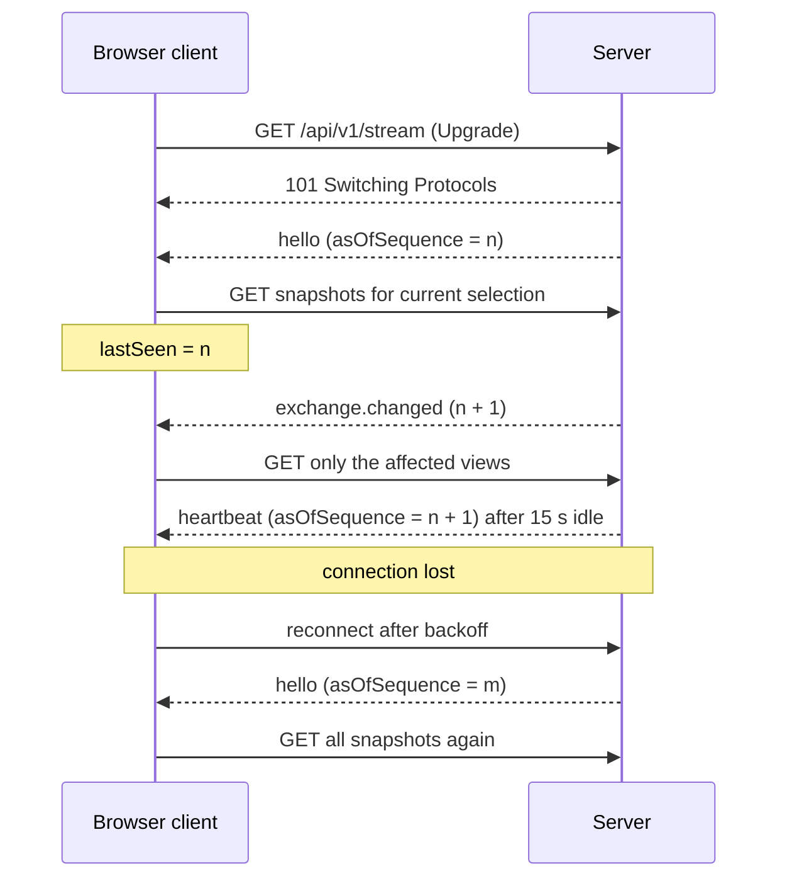

# Real-time Stream Contract

This document is the shared real-time protocol for Sprint 3 ([issue #71](https://github.com/co-rtex/tradegrid/issues/71)). The exchange event hub ([#72](https://github.com/co-rtex/tradegrid/issues/72)), the WebSocket endpoint ([#73](https://github.com/co-rtex/tradegrid/issues/73)), the frontend client ([#74](https://github.com/co-rtex/tradegrid/issues/74)), the connection indicator ([#75](https://github.com/co-rtex/tradegrid/issues/75)), and live trading-desk refresh ([#77](https://github.com/co-rtex/tradegrid/issues/77)) build against it independently. Change it through a pull request before changing code that depends on it.

It extends the [Sprint 2 API and Exchange Contract](api.md). Every REST endpoint there stays authoritative and unchanged.

## Design in One Paragraph

The stream sends small **invalidation notifications**, not data. After a submission commits, every connected client receives one `exchange.changed` event saying which symbol and accounts changed and the committed acceptance sequence. A client that cares re-fetches the affected REST snapshots. Events carry no balances, books, or orders, so a missed or late event can never leave a client showing wrong numbers: the worst case is a delayed refresh. The socket is one-way (server to client) and never accepts orders; `POST /api/v1/orders` stays the only write path.

## Scope

In scope: one endpoint, three message types, ordering and gap rules, heartbeats, slow-client and shutdown behavior, reconnect, and client-side filtering.

Out of scope: a live market-data feed (all prices and trades are simulated), message replay or catch-up history, authentication or per-user authorization, server-side subscriptions or filters, and anything sent from client to server.

`userId` is a **demo selector, not an authentication boundary**. Every connected client receives every event, including the user IDs of both counterparties. That is acceptable for the two-account demo and must not be relied on for privacy.

## Endpoint

`GET /api/v1/stream`

- A standard WebSocket upgrade ([RFC 6455](https://www.rfc-editor.org/rfc/rfc6455)) on the same host and port as the REST API. It takes no query parameters; unknown ones are ignored.
- Browser clients connect to `ws://` (or `wss://`) plus the page's own host: `new WebSocket(\`${location.protocol === "https:" ? "wss" : "ws"}://${location.host}/api/v1/stream\`)`.
- No subprotocol is negotiated.

Upgrade failures use the [error body](api.md#errors) from the REST contract:

| Status | `code` | When |
| --- | --- | --- |
| 403 | `FORBIDDEN_ORIGIN` | The `Origin` header is present and not allowed (below). |
| 405 | `METHOD_NOT_ALLOWED` | Not a `GET`. Includes `Allow: GET`. |
| 426 | `UPGRADE_REQUIRED` | A plain `GET` without a WebSocket upgrade. Includes `Upgrade: websocket`. |

**Origin policy.** Allowed: requests with no `Origin` header (non-browser tools and tests), same-origin requests (the `Origin` host equals the request `Host`), and the Vite development origins `http://localhost:5173` and `http://127.0.0.1:5173`. #73 may make the list configurable but must keep these defaults.

## Messages

Every message is one UTF-8 JSON text frame with this envelope:

```json
{ "type": "exchange.changed", "version": 1, "asOfSequence": 7, "sentAt": "2026-10-20T15:00:07Z", "data": { } }
```

| Field | Type | Meaning |
| --- | --- | --- |
| `type` | string | `hello`, `exchange.changed`, or `heartbeat`. |
| `version` | integer | Protocol version, `1`. A client that receives another version closes the socket and reports a protocol error. |
| `asOfSequence` | integer | Acceptance sequence of the last committed submission when the message was produced. `0` before any order. Same counter as the order `sequence` and orderbook `asOfSequence` in [api.md](api.md). |
| `sentAt` | string | Server time in RFC 3339 UTC. Informational only; never used for ordering. |
| `data` | object | Type-specific payload, always an object. |

Clients ignore unknown `type` values and unknown fields so the server can add them later without breaking older clients.

### `hello`

Sent once, first, immediately after the upgrade.

```json
{
  "type": "hello",
  "version": 1,
  "asOfSequence": 2,
  "sentAt": "2026-10-20T15:00:05Z",
  "data": { "heartbeatSeconds": 15 }
}
```

`asOfSequence` is the committed sequence at the moment this connection was subscribed. **The server guarantees an `exchange.changed` event for every commit with a larger sequence**, in order, for as long as the connection stays open. (#72: register the subscriber and read the committed sequence atomically, so no commit falls between them.)

### `exchange.changed`

Sent once per committed submission, after the book, orders, executions, and accounts are published. Never sent for rejected requests or for submissions that fail and roll back.

Order rests with no fill:

```json
{
  "type": "exchange.changed",
  "version": 1,
  "asOfSequence": 1,
  "sentAt": "2026-10-20T15:00:01Z",
  "data": { "symbol": "AAPL", "orderId": "ord-1", "userId": "alice", "executionCount": 0, "affectedUserIds": ["alice"] }
}
```

Order that traded against another account (fixture [03-partial-fill](fixtures/03-partial-fill.json)):

```json
{
  "type": "exchange.changed",
  "version": 1,
  "asOfSequence": 2,
  "sentAt": "2026-10-20T15:00:02Z",
  "data": { "symbol": "AAPL", "orderId": "ord-2", "userId": "bob", "executionCount": 1, "affectedUserIds": ["alice", "bob"] }
}
```

| `data` field | Type | Meaning |
| --- | --- | --- |
| `symbol` | string | The submitted order's symbol. Only this symbol's book and executions changed. |
| `orderId` | string | The accepted order. |
| `userId` | string | The account that submitted it. |
| `executionCount` | integer | Executions this submission produced, `0` or more. |
| `affectedUserIds` | array of strings | Every account whose orders or balances changed: the submitter plus each counterparty, unique and sorted. |

`asOfSequence` is the accepted order's `sequence`. Because each committed submission takes the next acceptance sequence, **consecutive `exchange.changed` events on one connection have consecutive sequences** (`n`, then `n + 1`). Any jump means events were missed.

### `heartbeat`

Sent whenever the server has sent nothing on a connection for `heartbeatSeconds` (15). `data` is `{}`.

```json
{ "type": "heartbeat", "version": 1, "asOfSequence": 2, "sentAt": "2026-10-20T15:00:20Z", "data": {} }
```

Heartbeats let browser code, which cannot see WebSocket ping frames, detect a dead connection, and their `asOfSequence` reveals missed events during quiet periods.

### Client to server

Clients send no data messages. The server closes a connection that sends a text or binary message with close code `1003` (unsupported data); orders are never accepted over the socket. WebSocket control frames (ping, pong, close) are fine.

## Ordering, Gaps, and Duplicates

Each client keeps `lastSeen`, the highest sequence it has accounted for.

| Message | Condition | Client action |
| --- | --- | --- |
| `hello` | any | Set `lastSeen = asOfSequence`, then re-fetch every snapshot it displays. If `asOfSequence` is lower than a `lastSeen` from an earlier connection, the server restarted: discard everything held and treat this as a fresh start. |
| `exchange.changed` | `asOfSequence <= lastSeen` | Duplicate or stale: ignore. |
| `exchange.changed` | `asOfSequence == lastSeen + 1` | Set `lastSeen`. Refresh the views this event affects (see Client-side Filtering). |
| `exchange.changed` | `asOfSequence > lastSeen + 1` | Gap: set `lastSeen = asOfSequence` and re-fetch every displayed snapshot. |
| `heartbeat` | `asOfSequence > lastSeen` | Gap: same as above. |
| `heartbeat` | otherwise | Nothing beyond resetting the idle timer. |

The server never sends duplicates or out-of-order events on one connection in normal operation; the rules above make clients correct even if it did.

A `GET` started after a client receives an event always reflects at least that event's sequence, because events are only sent after commit. `GET /api/v1/orderbook` reports its own `asOfSequence`; clients may use it to discard a response older than one they already applied.

## Client-side Filtering and Selection Changes

The server broadcasts every event. Each client decides what to refresh for its current selection (one `userId` and one `symbol` in the trading desk):

- `data.symbol` equals the selected symbol → refresh that symbol's orderbook and executions.
- `affectedUserIds` contains the selected user → refresh that user's account and orders.
- Neither → ignore the event (still update `lastSeen`).

Bursts of events should be coalesced into one refresh per view (a short debounce of about 100–250 ms) to avoid request storms.

To keep data for a previous selection from appearing:

1. Each selection change increments a client-side **selection generation** and starts fresh fetches for the new selection.
2. Every fetch records the generation it started under. A response whose generation is no longer current is discarded, even if it arrives last.
3. Within one generation, a response for a view is discarded if a newer request for the same view has already been applied.

A selection change during reconnect follows the same rules: the fetches triggered by the new `hello` use whatever selection is current at that moment.

## Connection Lifecycle



**Client connection states** (#74 exposes them; #75 displays them):

| State | Meaning |
| --- | --- |
| `connecting` | First connection attempt, before `hello`. |
| `connected` | `hello` received; events are flowing. |
| `reconnecting` | Connection lost; waiting for or making another attempt. |
| `disconnected` | Closed on purpose by the client, or reconnect gave up. |
| `error` | Protocol error (invalid JSON, missing envelope fields, unsupported `version`). No automatic reconnect, since the same server would fail again. |

These states describe the notification stream only. They do not say whether the REST API is reachable or whether an order succeeded.

**Idle detection.** If a `connected` client receives no message for `2 × heartbeatSeconds` (30 s), it closes the socket and reconnects.

**Reconnect.** Delays of 0.5 s, 1 s, 2 s, 4 s, ... doubling to a cap of 30 s, each with ±20% random jitter. The delay resets after a `hello`. After 10 consecutive failed attempts the client stops in `disconnected` and offers a manual retry. Explicit cleanup (for example a React unmount) closes the socket and cancels any pending reconnect. Reconnecting never retries an order `POST`.

## Server Behavior

**When events are produced.** The exchange produces one event per committed submission, after publishing its state, from the `SubmitResult`: `symbol`, `orderId`, `userId`, and `asOfSequence` from the order; `executionCount` and the counterparties in `affectedUserIds` from the executions. It must not block while holding the exchange lock: hand-off to subscribers is non-blocking. Events reach each subscriber in acceptance order.

**Slow clients.** Each connection has a bounded queue of 64 pending messages. If a message cannot be queued because the queue is full, the server drops that subscriber and closes the socket with code `1013` (try again later). The client reconnects and re-fetches; nothing is lost because REST is authoritative. A slow client can never delay trading or other clients.

**Writes and liveness.** Each write has a 5 s timeout; a write that times out closes the connection with `1011`. The server sends a WebSocket ping every 30 s and closes the connection if no pong arrives within 10 s.

**Shutdown.** On server shutdown every connection is closed with `1001` (going away) and every subscription is released.

**Close codes used by the server:**

| Code | Meaning | Client reaction |
| --- | --- | --- |
| `1001` | Server shutting down | Reconnect with backoff. |
| `1003` | Client sent a data message | Bug in the client: `error`. |
| `1011` | Server-side failure or write timeout | Reconnect with backoff. |
| `1013` | Slow consumer, subscription dropped | Reconnect with backoff, then re-fetch. |

## Development Proxy

In development the frontend (Vite, port 5173) and backend (port 8080, `TRADEGRID_HTTP_PORT`) run separately. The browser talks only to Vite, which forwards API and WebSocket traffic, so the frontend uses same-origin URLs everywhere:

```ts
// frontend/vite.config.ts
export default defineConfig({
  plugins: [react()],
  server: {
    proxy: {
      '/api': { target: 'http://127.0.0.1:8080', ws: true },
      '/health': { target: 'http://127.0.0.1:8080' },
    },
  },
})
```

`ws: true` is required for the stream. The proxy keeps the browser's `Origin` (`http://localhost:5173`), which the origin policy above allows. Whichever of #44 or #73 needs the proxy first adds it.

## Implementation Choice

The backend uses [`github.com/coder/websocket`](https://github.com/coder/websocket) (formerly `nhooyr.io/websocket`):

- It works directly with `net/http` handlers (`websocket.Accept`), so it fits the existing `httpapi` router without a framework.
- Reads, writes, and close take a `context.Context`, which gives write timeouts and server-shutdown cancellation without extra goroutine plumbing.
- It has built-in ping/pong, origin checks (`OriginPatterns`), and read limits, and it has no other dependencies.
- It is actively maintained.

Alternatives considered: `github.com/gorilla/websocket` is also maintained and widely used, but needs manual write serialization and deadline handling; `golang.org/x/net/websocket` itself recommends other packages; the standard library has no WebSocket server. The frontend uses the browser's built-in `WebSocket` and needs no package.

#73 adds the dependency to `backend/go.mod` and sets a small read limit (for example 512 bytes), since clients send no data.
