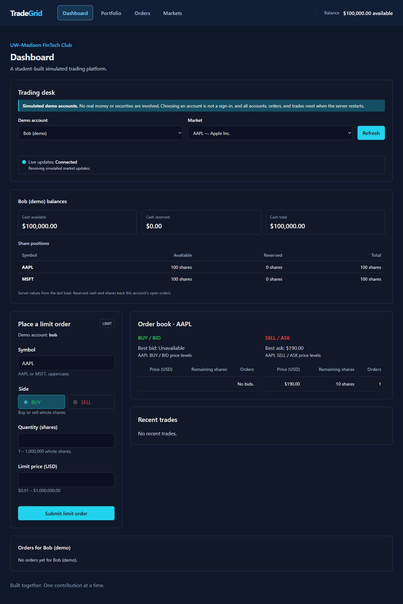
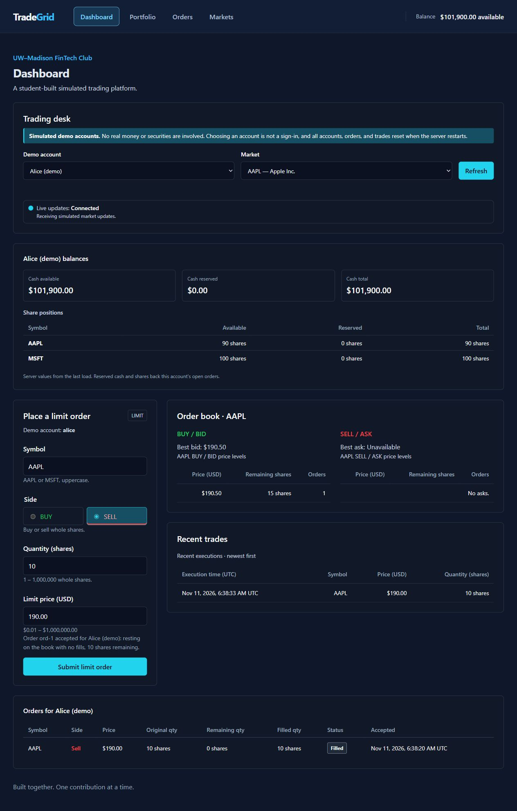
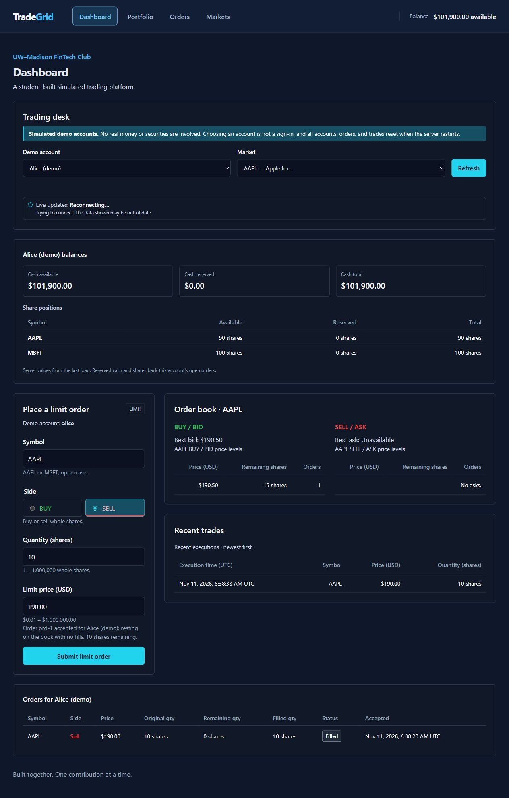
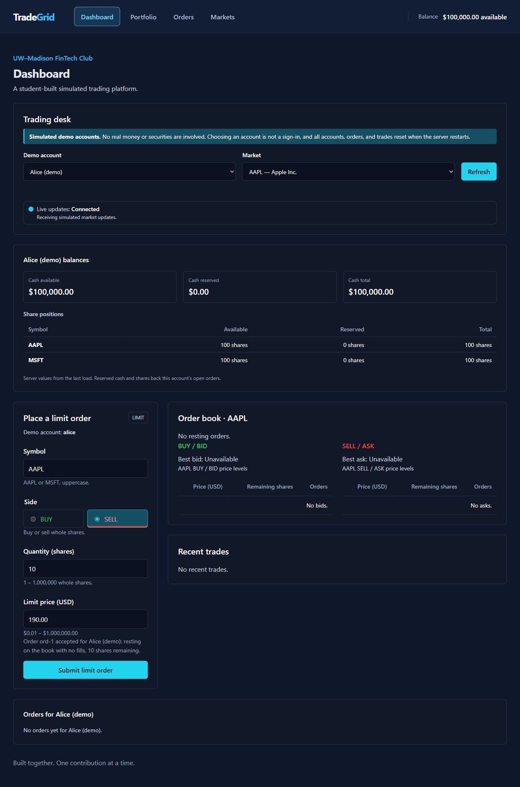

# Live trading desk verification (#77)

Verified against the local Go backend and Vite frontend on November 11, 2026.
All values and orders below are simulated demo data.

## Automated checks

- Go 1.27.4, Windows amd64: `gofmt -l .` returned no files after normalizing
  the Windows checkout's line endings; `go vet ./...` and `go test ./...` passed
  for all 11 backend packages. Formatting produced no tracked source changes.
- Frontend: all 370 tests in 14 files, lint, typecheck, and production build passed.
- GitHub Actions: backend, database migration, and frontend jobs passed.

## Two-tab live update check

1. Start `go run ./cmd/server` in `backend/` and `npm run dev` in `frontend/`.
2. Open `http://127.0.0.1:5173/` in two tabs, with Alice selected in one and Bob
   in the other. Both show **Connected**.
3. Alice sells 10 AAPL at $190.00. Without refreshing Bob's tab, it shows the
   $190.00 ask for 10 shares while Bob's own orders remain empty.
4. Bob buys 25 AAPL at $190.50. Without refreshing Alice's tab, her sell order
   becomes **Filled**, her available cash becomes $101,900.00, her AAPL position
   becomes 90 shares, the executions table shows 10 shares traded at $190.00,
   and the book shows Bob's remaining bid for 15 shares at $190.50.

## Disconnect and restart check

1. Stop the backend. The desk changes to **Reconnecting…**, warns that data may
   be out of date, and keeps manual **Refresh** available.
2. Press **Refresh** while the backend is stopped. The balance placeholder and
   visible errors replace snapshots the server cannot confirm.
3. Restart the backend. Without another refresh or page reload, the desk
   reconnects, clears the old server's snapshots, and displays the reset
   $100,000.00 balance, 100 AAPL shares, and empty orders, book, and executions.
   No order is resubmitted.

